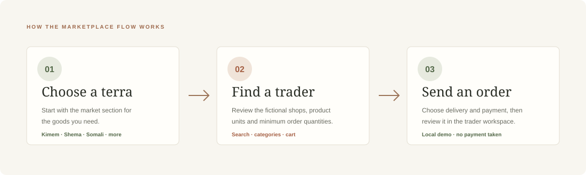
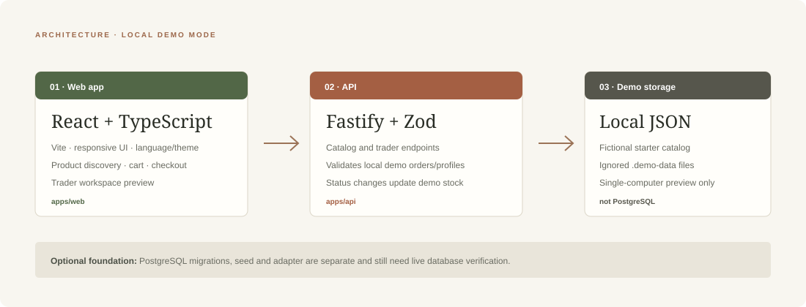

# MerkatoLink

### A digital wholesale marketplace concept for Addis Ababa’s Merkato

MerkatoLink helps retailers explore fictional wholesale traders by **terra**, compare product units and minimum quantities, and prepare a demo order. A trader workspace previews order handling, stock updates and a landed-cost illustration.


> **Portfolio demo only.** All shops, people, phone numbers, products, prices, orders and business figures are fictional. The default backend is a local demo store. This project is not secure or complete enough for real customer, trader, financial or accounting data.

> **Hosting status:** You can push this code to GitHub now, but the current API should not be exposed as a public interactive demo. Read the [GitHub and deployment guide](docs/DEPLOYMENT.md) first; it explains the remaining backend security and persistence work.

## Publishing safety checklist

Before making the repository public, check the files and commit history—not just this README:

- [ ] No `.env` file containing credentials or secrets.
- [ ] No API keys, passwords or real database connection strings.
- [ ] No real customer, trader or personal information.
- [ ] `apps/api/.demo-data/` is excluded from Git.
- [ ] No private documents or unrelated personal files.
- [ ] No credentials accidentally committed in earlier Git commits.
- [ ] No production database credentials in configuration files.

In VS Code's terminal, run `git status` to review pending files and `git ls-files` to review tracked files. `.gitignore` excludes `.env` and `.demo-data`, but it cannot remove files already committed. The current history contains five commits; a scan found only the tracked `.env.example` with local placeholder credentials (`local_only_change_me`), and no tracked `.env`, `.demo-data` files or obvious real secrets. Review that history yourself before making the repository public.

## Contents

- [Run locally](#run-locally)
- [Explore the demo](#explore-the-demo)
- [Demo data and reset](#demo-data-and-reset)
- [Languages](#languages)
- [Architecture](#architecture)
- [Project structure](#project-structure)
- [Checks](#checks)
- [Known limitations](#known-limitations)
- [GitHub](#github)

## Run locally

**Requirements:** Node.js 22 or newer and Corepack. These commands are for Windows PowerShell in VS Code.

1. Open the repository folder in VS Code.
2. Select **Terminal → New Terminal**.
3. Install workspace dependencies and start the web app and API:

```powershell
corepack.cmd pnpm install
corepack.cmd pnpm dev
```

Open the Vite URL printed in the terminal—usually `http://localhost:5173`. If that port is busy, Vite prints a different one. The local API normally listens on `http://localhost:4000`. Keep the terminal running while exploring; press **Ctrl+C** to stop the dev processes.

The default demo needs no Docker, database, `.env` file, live credentials or payment provider.

## Explore the demo

1. Choose a **terra** such as Kimem, Shema or Somali.
2. Open a fictional trader and browse the catalog. Search, filter categories and review selling units and minimum quantities.
3. Add a product to the bag, then choose pickup or delivery and a payment preference.
4. Open **Trader workspace (preview)** to inspect demo orders. Confirming an order reduces demo stock; cancelling a confirmed order restores it.
5. Try the light/dark toggle, language selector, and **Merkato Daily** business-news cards.

The checkout is a simulated order request. It does not take payment or contact a real trader. VAT and delivery calculations are demo behavior and should not be used as tax or commercial advice.

### Create a demo profile

Choose **Create account**, enter a fictional name and the placeholder number `09XX XXX XXX`, select a language and create the profile. No password is created and this does not sign you in. The profile is stored in the local demo JSON data. The placeholder is not a valid number for submitting an order; use fictional data when exercising the form.

### Review the flow



## Demo data and reset

The API starts with a fictional catalog defined in its source. Demo accounts, orders and adjusted stock are written beneath `apps/api/.demo-data/`, which Git ignores. This JSON store is for a single-computer preview; it is not PostgreSQL, cloud storage or multi-user persistence.

To reset the generated demo profiles, orders and stock adjustments:

1. Stop the dev processes with **Ctrl+C**.
2. From the repository root, run:

```powershell
Remove-Item -Recurse -Force .\apps\api\.demo-data
corepack.cmd pnpm dev
```

The API recreates demo storage from the fictional starter catalog as it is used again. This removes local demo state in that folder.

## Languages

The language selector offers English, Amharic, Tigrinya, Afaan Oromo, Somali, Afaraf, Sidaamu Afoo, Wolaytta and Gurage. The main storefront, How it works, About, news, account form and core order labels have expanded translations for Amharic, Tigrinya, Afaan Oromo and Somali. Afaraf, Sidaamu Afoo, Wolaytta and Gurage remain preview-level. Product and trader names are demo catalog content and may stay in their original language; some operational labels are not translated yet.

## Merkato Daily

Merkato Daily is a small, manually curated section of Ethiopia business reporting with article links and publication dates. It is static sample content, not a live feed or a MerkatoLink price source. Review each linked publisher for the full article.

## Architecture



| Area                         | Technology                     | Current role                                                     |
| ---------------------------- | ------------------------------ | ---------------------------------------------------------------- |
| Web                          | React, TypeScript, Vite, CSS   | Storefront, checkout, account-profile form and trader preview    |
| API                          | Fastify, TypeScript, Zod       | Catalog endpoints and validated local demo orders/profiles       |
| Default storage              | Local JSON files               | Fictional profiles, orders and stock adjustments on one computer |
| Optional database foundation | PostgreSQL migrations and seed | Separate development path; requires live-database verification   |

The UI calls the local Fastify API directly. The default demo has no authentication or production-grade access controls. The optional PostgreSQL path is separate from the default local JSON flow.

## Project structure

```text
apps/
  web/                 React + TypeScript storefront and trader preview
  api/                 Fastify API and local fictional demo store
packages/
  db/                  PostgreSQL migrations, seed and adapter
  shared/              Shared schemas and types
docs/
  assets/              README diagrams and concept artwork
  *.md                 API, deployment, research and coverage notes
```

## Checks

Run these from the repository root:

```powershell
corepack.cmd pnpm typecheck
corepack.cmd pnpm test
corepack.cmd pnpm lint
corepack.cmd pnpm build
```

## Known limitations

- The local profile is not authentication. There are no secure owner/staff roles or production tenant-isolation policies.
- The JSON demo backend is not intended for deployment or simultaneous users. The PostgreSQL migration, seed and order path still need verification against a live database.
- There is no live payment integration, e-invoice accreditation, automated email, or real trader onboarding.
- Dashboard figures and Rate Shock values are illustrations; they are not live SQL reporting or financial advice.
- Language coverage is incomplete; see [Languages](#languages).
- Deployment is not configured by this repository. Do not expose the local demo API publicly or enter real personal/business data.

For detailed feature-by-feature status, read [the proposal coverage audit](docs/PROBLEM_COVERAGE.md). Also see [API notes](docs/API.md), [deployment notes](docs/DEPLOYMENT.md), [research](docs/RESEARCH.md), [assumptions](docs/ASSUMPTIONS.md) and [security notes](SECURITY.md).

## GitHub

This repository does not contain a GitHub remote by default. To publish your own copy:

1. Create an empty repository on GitHub (do not initialize it with another README, `.gitignore` or license).
2. In the VS Code terminal, run `git status` and check that no `.env`, credentials or real data are listed.
3. Stage and commit the project, then add your repository URL and push:

```powershell
git add -A
git commit -m "Complete MerkatoLink demo and documentation"
git remote add origin https://github.com/YOUR-USERNAME/YOUR-REPOSITORY.git
git push -u origin main
```

Keep `.env` and `apps/api/.demo-data/` out of commits. The repository’s `.gitignore` excludes these local files. Never commit credentials or real personal/business data.
