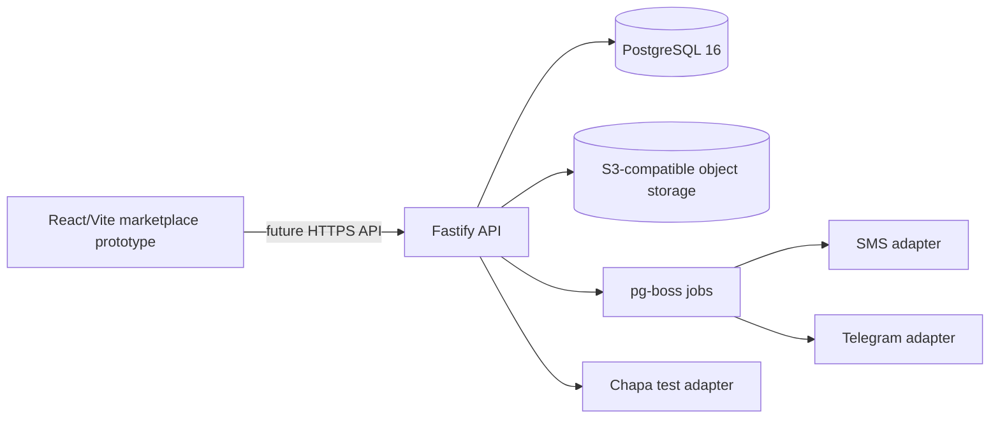

# Architecture (current foundation)

Today only the Vite web app, Fastify `/healthz` and `/readyz`, and SQL foundation exist. Browser-to-API business routes and provider integrations in the diagram are future work. Production auth is intended to use phone OTP/email with secure server sessions; no browser-side database credentials should authorize business operations. PostgreSQL RLS remains a second authorization boundary for tenant-owned records.

LandedBirr computes CIF then configured duty, excise, VAT, surtax, withholding and clearing adjustments. Every setting must be effective-dated and auditable. `v_product_margin` and `v_rate_shock` should compare current and proposed rate calculations. A confirmed order must lock and decrement the correct location inventory in one transaction; a unique order commission key makes broker commission creation idempotent.
