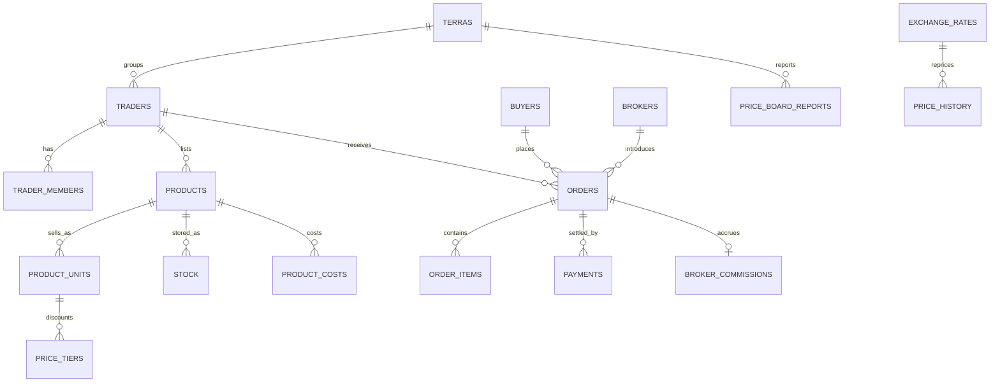

# ERD (logical target)

The migration is an initial implementation of core entities; some items in this target model are not implemented yet. See the SQL migration for current columns and constraints.
